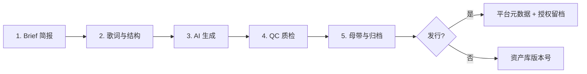

# 专业 AI 歌曲创作 SOP（Standard Operating Procedure）

> 目标：**高效、稳定、性价比最优**地完成从创意到可发布成品；兼顾免费探索与商业发行路径。  
> 适用：独立音乐人、短视频配乐、品牌单曲、MCN 批量生产。

---

## 0. 工具性价比矩阵（2026 年 3 月校准）

| 场景 | 首推工具 | 免费额度 | 可下载 | 商业授权 | 付费入门 | 稳定性 | 说明 |
|------|----------|----------|--------|----------|----------|--------|------|
| **完整歌曲（词曲唱一体）** | [Suno](https://suno.com) | 50 积分/天 | 极少/需购 | Pro 起 | **$8–10/月**（年付更低） | ★★★★☆ | 结构完整度行业领先，队列共享是免费层主要成本 |
| **哼唱/旋律导向** | Suno + 自录哼唱 | 同上 | 同上 | 同上 | 同上 | ★★★★☆ | Custom 模式贴旋律 |
| **纯器乐/BGM** | MusicGen（开源） | 本地无限 | ✅ | 非商用权重* | **$0**（算力自付） | ★★★☆☆ | 无人声；CPU 可跑 small |
| **视频 BGM 快速出曲** | [Soundraw](https://soundraw.io) | 可生成预览 | 付费 | 付费计划 | ~$17/月 | ★★★★★ | 不负责人声 |
| **App/直播铺量** | [Mubert](https://mubert.com) | 25 条/月 | 5 MP3 | 付费 | ~$12/月 | ★★★★☆ | 偏氛围电子 |
| **浏览器即用低成本** | [Tunely](https://tunelyai.com) | 4 首/天 | MP3 $1.99/首 | 付费档 | 按首计费 | ★★★☆☆ | 适合试水 |
| Udio | — | 10 积分/天 | ❌ 全站禁用下载 | 个人非商用 | $10/月 | ★★☆☆☆ | **当前不建议纳入生产线** |
| 进阶混音/修音 | Audacity + UVR5 | 免费 | ✅ | N/A | $0 | ★★★★★ | 本地、可重复 |
| 歌词/策划 | Cursor / Claude / ChatGPT | 依订阅 | N/A | N/A | 已有即可 | ★★★★★ | 本 SOP 的「大脑层」 |

\* MusicGen 权重许可以 Meta CC-BY-NC 为准；**商业发行请走 Suno Pro 或自录重制**，勿直接上架 NC 生成物。

### 性价比结论（按角色）

1. **零预算验证想法**：Suno 免费积分 + 本仓库歌词/Prompt → 试听；器乐备选 MusicGen。  
2. **月产 &lt; 20 首可发行**：Suno **Pro**（约 $8/月年付）+ Audacity，单首边际成本最低。  
3. **大量无人声 BGM**：MusicGen 或 Soundraw，视是否要「一键成片」二选一。  
4. **拒绝平台锁定**：MusicGen 器乐 + 真人演唱/自研旋律 + DAW（Reaper  $60 买断）— 前期人力更高，长期 IP 最稳。

---

## 1. 流程总览（五阶段）



**铁律**：每次生成只改 **一个变量**；固定歌词/结构/情绪主线，实验项外置记录（见 §4）。

---

## 2. 阶段详解

### 阶段 1 — 歌曲简报（15 分钟）

必填字段（写入 `songs/<slug>/brief.md`）：

| 字段 | 示例 |
|------|------|
| 歌名 / slug | 山城夜灯 / `chongqing-night-lights` |
| 听众与场景 | 城市文旅短视频、家乡题材 |
| 叙述视角 | 第一人称、漫步取景 |
| 情绪弧线 | 黄昏怀旧 → 副歌昂扬 → 桥段沉静 → 大副歌释放 |
| 结构 | V1 – Pre – C – V2 – Pre – C – Bridge – C – Outro |
| BPM / 调性 | 92 BPM，Am |
| 禁止项 | 英文演唱、EDM drop、刺耳合成音色 |
| 成功标准 | 副歌 2 秒内可跟唱；人声贴词无糊 |

### 阶段 2 — 歌词与结构（30–60 分钟）

1. 用 LLM 出 **3 版 hook（副歌金句）**，人工选定 1 句。  
2. 按结构填词；**每段标注 `[Verse]` `[Chorus]`** 等 Suno 可识别标签。  
3. 朗读节拍：中文每行 7–12 字为宜；硬拗口腔当即改。  
4. 冻结 `lyrics.zh.md` 版本号（如 `v1.0`）。

**本仓库示例**：[`songs/chongqing-night-lights/lyrics.zh.md`](../songs/chongqing-night-lights/lyrics.zh.md)

### 阶段 3 — AI 生成（20–40 分钟/轮）

#### 路径 A：Suno（推荐，完整歌曲）

1. 打开 **Custom**，Style 框粘贴 [`suno-prompt.txt`](../songs/chongqing-night-lights/suno-prompt.txt) 风格段。  
2. Lyrics 框粘贴带段落标签的完整歌词。  
3. 一次生成 2 变体；**禁止**同时改风格与歌词。  
4. 命名规范：`{slug}--suno--pass{NN}--{改动摘要}`。  
5. 免费账户：优先完成试听与结构确认；需下载时升级 Pro 或按平台规则购买下载次数。

**Prompt 要点**：具体乐器 + BPM + 情绪 + 地理意象；避免「好听」「流行」等空词。

#### 路径 B：MusicGen（零成本器乐）

```bash
python3 scripts/generate_musicgen_segments.py \
  --out output/chongqing_instrumental.wav \
  --total-seconds 120
```

- 适合：BGM、人声另行录制、或 Suno 失败时的氛围参考轨。  
- 限制：无人声、分段拼接需在 DAW 检查接缝（交叉淡化 0.5–1.5s）。

#### 路径 C：人声后期（可选）

- **UVR5**：分轨 / 消伴奏（本地）。  
- **Audacity**：EQ、压缩、轻度混响；目标响度 **-14 LUFS**（流媒体友好）。

### 阶段 4 — QC 质检（10 分钟/版本）

| 维度 | 检查项 | 不通过处理 |
|------|--------|------------|
| 结构 | 桥段、副歌重复次数符合 brief | 仅改 `[Bridge]` 提示重生成 |
| 咬字 | 关键词可听清（歌名、地名） | 降 guidance / 换「clear diction」描述 |
| 音准与节奏 | 无明显跑调、抢拍 | 换 pass 或缩短该段 regenerate |
| 身份一致 | 2 分钟情绪弧线不断裂 | 固定 Style，只动 Outro 提示 |
| 合规 | 采样民族元素无侮辱性表述 | 人工改词 |

**听歌顺序**（防误判）：① 整体走势 → ② 人声与歌词 → ③ 节奏与配器 → ④ 仅对比目标段落 A/B。

### 阶段 5 — 母带与归档（15 分钟）

1. 导出：`wav` 归档 + `mp3 320k` 分发。  
2. 记录 `generation-log.md`：日期、平台、完整 Prompt、歌词版本、决策（采用/弃用原因）。  
3. Git 标签：`song/{slug}/v1.0`。  
4. 商业发行：保留 Suno Pro 发票/订阅截图 + 平台 ToS 截图。

---

## 3. 稳定性与排错

| 症状 | 可能原因 | 对策 |
|------|----------|------|
| 副歌提前、结构乱 | Prompt 过长或风格冲突 | 缩短 Style；删掉矛盾流派词 |
| 人声糊、吃字 | 编曲过满 | 加「dry vocal, sparse verse」；Pre 段降密度 |
| 生成排队久 | Suno 免费队列 | 错峰；或 Pro |
| MusicGen OOM | 内存不足 | 用 `small`、缩短 `--segment-seconds` |
| 接缝咔嚓声 | 段切硬拼 | ffmpeg `acrossfade` 或 Audacity 交叉淡化 |

---

## 4. 版本记录模板（`generation-log.md`）

```markdown
## Pass 03 — 2026-03-19
- Platform: Suno Custom
- Lyric: v1.0
- Changed: 仅 Pre-Chorus — 加入「dry vocal」
- Result: 采用 chorus；verse2 抢拍 → Pass 04 只改鼓组描述
- File: chongqing-night-lights--suno--pass03--dry-vocal.wav
```

---

## 5. 重庆主题 2 分钟单曲 — 最快免费路径

| 步骤 | 动作 | 成本 |
|------|------|------|
| 1 | 使用本仓库歌词 + Suno Prompt | $0 |
| 2 | Suno 免费生成 2 变体试听 | $0 |
| 3 | 需 MP3 发行 → Suno Pro 或平台单次购下载 | $8/月 或按次 |
| 备选 | 运行 `generate_musicgen_segments.py` 得 2 分钟器乐 | $0（耗时） |

---

## 6. Git 与资产协作（本仓库）

远程已关联时，日常推送：

```bash
git add .
git commit -m "docs: update song SOP or assets"
git push -u origin <your-branch>
```

初始化新本地副本时（将 URL 换成你的仓库）：

```bash
git init
git add .
git commit -m "Initial commit"
git remote add origin https://github.com/<user>/codex-dev-workspace.git
git push -u origin main
```

---

## 7. 相关文件

- SOP 本文：`docs/AI_SONG_CREATION_SOP.md`
- 重庆单曲歌词：`songs/chongqing-night-lights/lyrics.zh.md`
- Suno 风格 Prompt：`songs/chongqing-night-lights/suno-prompt.txt`
- 本地器乐生成：`scripts/generate_musicgen_segments.py`
- 产出目录：`output/`（生成后）

---

*文档版本：1.0 · 维护：随平台 ToS/定价变更每季度复核 §0 矩阵。*
